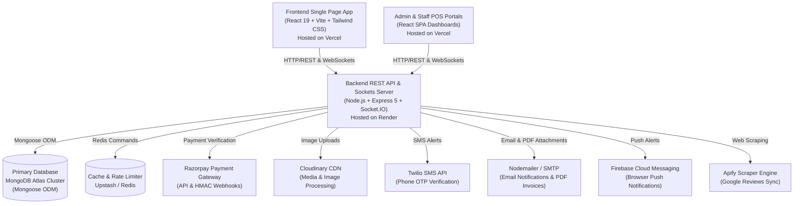
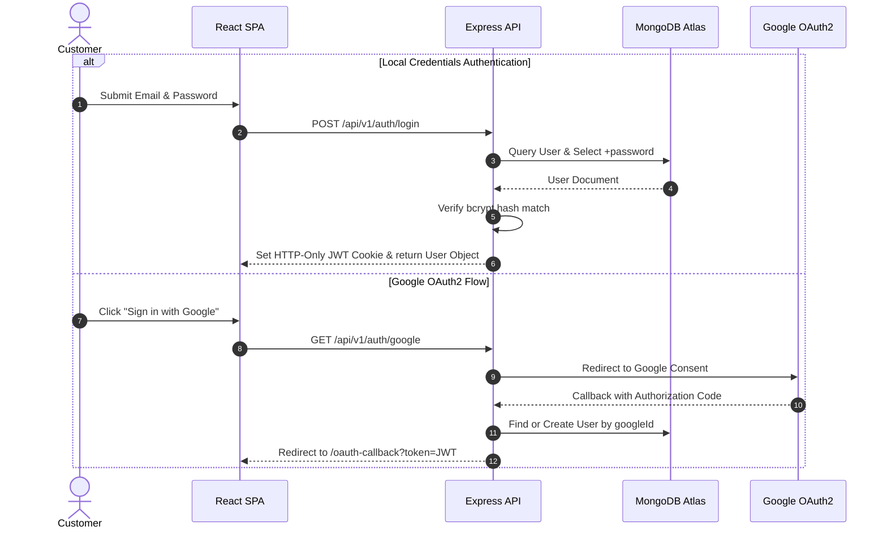
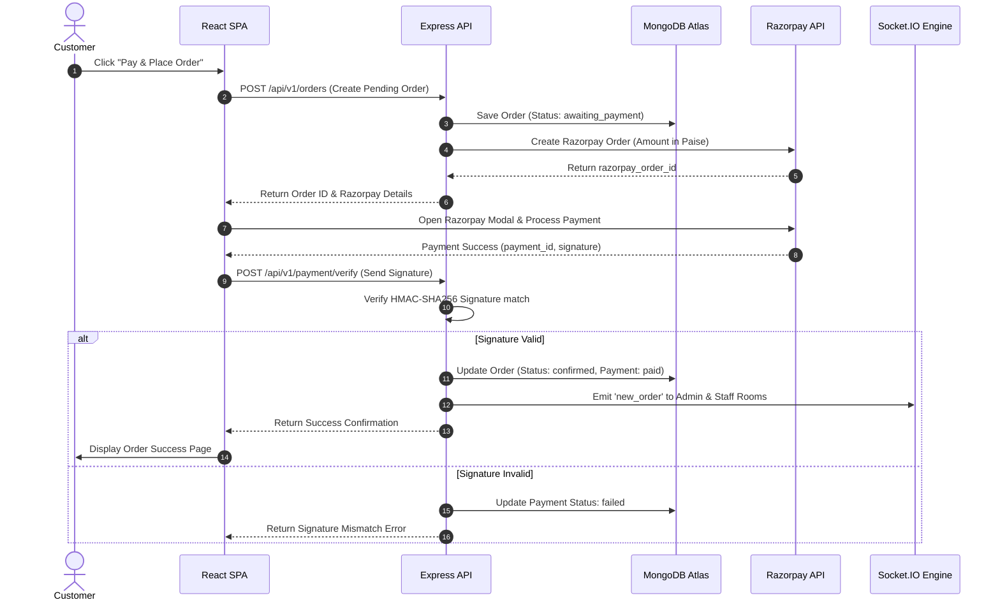
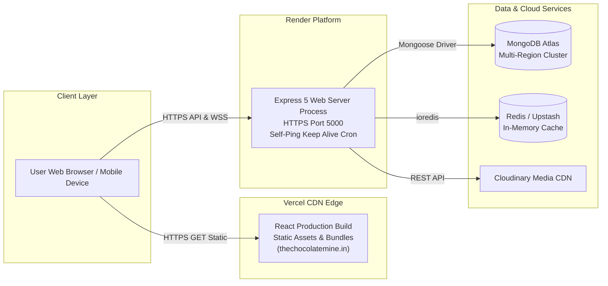

# Document 4: Technical Architecture

This document provides a technical specification of the system architecture, component topology, authentication model, payment gateway verification, data pipelines, real-time WebSocket infrastructure, and hosting deployment model for **The Chocolate Mine**.

---

## 1. High-Level System Architecture

The application is built on a modern decoupled **MERN** architecture (MongoDB, Express.js, React, Node.js) with real-time WebSocket capabilities, cloud media hosting, and third-party API integrations.

---

## 2. Frontend Architecture

### Core Stack
- **Framework:** React 19 (`react`, `react-dom`) initialized with Vite (`vite`).
- **State Management:** Dual-layer state architecture:
  - **Global Application & Cart State:** Redux Toolkit (`@reduxjs/toolkit`, `react-redux`) via `cartSlice.js`.
  - **Authentication & UI Contexts:** React Context API (`AuthContext`, `ThemeContext`, `LocationContext`, `WishlistContext`).
  - **Server Data Caching:** `@tanstack/react-query` for asynchronous API state handling.
- **Routing:** `react-router-dom` v7 with route guard wrappers (`AdminRoute`, `StaffRoute`, `ProtectedRoute`, `GuestRoute`, `PhoneVerificationGate`).
- **Styling & UI Components:** Tailwind CSS v3, Framer Motion v12 (animations), Lucide React & React Icons.
- **3D Graphics & Visualiser:** Three.js (`three`), `@react-three/fiber`, `@react-three/drei` for real-time 3D cake rendering.
- **Maps & Location:** Leaflet (`leaflet`, `react-leaflet`) for interactive address pinning.

---

## 3. Backend Architecture

### Core Stack
- **Runtime & Framework:** Node.js 20+, Express.js 5 (`express`).
- **Real-Time Communication:** Socket.IO v4 (`socket.io`).
- **Security & Middleware:** Helmet (`helmet`), CORS (`cors`), Compression (`compression`), Cookie Parser (`cookie-parser`), Morgan logging (`morgan`).
- **Database Access:** Mongoose ODM v9 (`mongoose`) connected to MongoDB Atlas.
- **Task Scheduling:** Node Cron (`node-cron`) for automated Google Reviews sync.

---

## 4. Sequence Diagrams & Request Flows

### 4.1 Authentication Flow (JWT & OAuth2)

---

### 4.2 Order Placement & Razorpay Payment Flow

---

### 4.3 Deployment Architecture

---

## 5. Third-Party Integration Matrix

| Integration | Transport Protocol | Authentication Method | Fallback Strategy |
| :--- | :--- | :--- | :--- |
| **Razorpay** | HTTPS REST / Webhooks | Key ID + Secret Key / Webhook Signature | Razorpay Webhook listener syncs orders if client disconnects before signature verification. |
| **Cloudinary** | HTTPS Multipart Upload | API Key + API Secret + Cloud Name | Client-side compression (`browser-image-compression`) limits upload sizes before transmission. |
| **Twilio** | HTTPS REST API | Account SID + Auth Token | Nodemailer Email OTP fallback if SMS delivery fails. |
| **Apify** | HTTPS REST API | Bearer API Token | Cached Google Reviews returned if Apify API rate limit or quota fails. |
