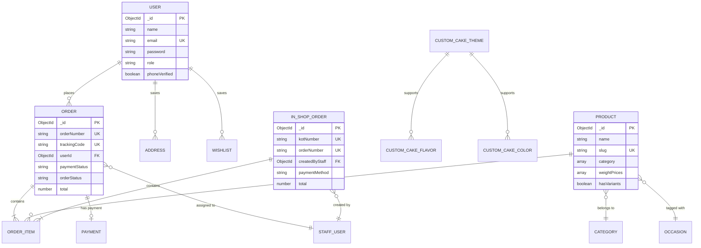

# Document 7: Database Design & Schema Reference

This document provides a technical specification of the database architecture, entity schemas, indexes, relationships, pre-save lifecycle hooks, and data lifecycle management in **The Chocolate Mine**.

---

## 1. Database Technology & Configuration

- **Database Engine:** MongoDB Atlas Cloud Document Store.
- **Object Data Modeling (ODM):** Mongoose ODM v9 (`mongoose`).
- **Connection Configuration:** `backend/src/config/db.js` using connection pooling (`maxPoolSize: 10`), auto-reconnect, and environment-driven connection string (`MONGODB_URI`).

---

## 2. Entity-Relationship Diagram (ERD)

---

## 3. Detailed Schema Specifications

### 3.1 `User` Schema
- **File:** [`backend/src/models/User.js`](file:///c:/Volume%20D/projects/freelancing/Chocolate-Mine-client-project%202/chocolate-mine-client-project/backend/src/models/User.js)
- **Primary Key:** `_id` (`ObjectId`)
- **Key Fields:**
  - `email`: `String` (Required, Unique, Lowercase)
  - `password`: `String` (`select: false`, bcrypt hashed with cost factor 12)
  - `role`: `String` (`enum: ['user', 'staff', 'admin']`, default: `'user'`)
  - `phone`: `String` (Sparse index, unconstrained uniqueness to allow multi-family profile orders)
  - `addresses`: Array of Subdocuments (`fullName`, `phone`, `street`, `city`, `pincode`, `lat`, `lng`, `isDefault`)
  - `wishlist`: Array of `ObjectId` references to `Product`
  - `fcmTokens`: Array of Firebase Cloud Messaging registration tokens

---

### 3.2 `Product` Schema
- **File:** [`backend/src/models/Product.js`](file:///c:/Volume%20D/projects/freelancing/Chocolate-Mine-client-project%202/chocolate-mine-client-project/backend/src/models/Product.js)
- **Primary Key:** `_id` (`ObjectId`)
- **Key Fields:**
  - `name`: `String` (Required, Sentence Case pre-save transformation)
  - `slug`: `String` (Required, Unique, Lowercase)
  - `category`: `[String]` (Multiple category tags)
  - `hasVariants`: `Boolean`
  - `weightPrices`: Array of `{ weight: String, price: Number }`
  - `image`: `String` (Cloudinary URL)
  - `isActive`: `Boolean` (Soft toggle for hiding/showing products)
  - `ratingsAverage`: `Number` (0 to 5)

---

### 3.3 `Order` Schema
- **File:** [`backend/src/models/Order.js`](file:///c:/Volume%20D/projects/freelancing/Chocolate-Mine-client-project%202/chocolate-mine-client-project/backend/src/models/Order.js)
- **Primary Key:** `_id` (`ObjectId`)
- **Key Fields & Indexes:**
  - `orderNumber`: `String` (Unique, Sparse, Generated via pre-save hook `TCM-YYYY-XXXX`)
  - `trackingCode`: `String` (Unique, Sparse)
  - `userId`: `ObjectId` (Ref: `User`, Index: `1`)
  - `paymentStatus`: `String` (`enum: ['pending', 'created', 'paid', 'failed', 'refunded']`, Index: `1`)
  - `orderStatus`: `String` (`enum: ['awaiting_payment', 'confirmed', 'out_for_delivery', 'delivered', 'cancelled']`, Index: `1`)
  - `items`: Array of subdocuments with `productId`, `qty`, `price`, `selectedWeight`, `sku`
  - `razorpayOrderId`: `String`
  - `razorpayPaymentId`: `String`
  - `razorpaySignature`: `String`
  - `createdAt`: `Date` (Index: `-1`)

---

### 3.4 `InShopOrder` Schema
- **File:** [`backend/src/models/InShopOrder.js`](file:///c:/Volume%20D/projects/freelancing/Chocolate-Mine-client-project%202/chocolate-mine-client-project/backend/src/models/InShopOrder.js)
- **Primary Key:** `_id` (`ObjectId`)
- **Key Fields:**
  - `kotNumber`: `String` (Unique sequential Kitchen Order Ticket code, e.g. `KOT-0142`)
  - `createdByStaff`: `ObjectId` (Ref: `User`)
  - `paymentMethod`: `String` (`enum: ['CASH', 'UPI', 'CARD']`)

---

## 4. Lifecycle Hooks & Automated Generators

1. **Sequential Order Number Generator (`Order.js` pre-save hook):**
   - Queries MongoDB for the highest `orderNumber` starting with `TCM-YYYY-`.
   - Increments sequence number (e.g. `TCM-2026-0001` -> `TCM-2026-0002`).
   - Retries up to 100 times to guarantee zero collision under concurrent requests.
2. **Item SKU Generator (`Order.js` pre-save hook):**
   - Combines Product Name, Category Code, Flavor Code, Weight Code, Date Code, and Sequence Number.
   - Format: `XXX-YYY-ZZ-WW-YYMMDD-XXX` (e.g. `CHO-CAK-TR-05-260912-001`).
3. **Bcrypt Password Hash (`User.js` pre-save hook):**
   - Automatically hashes plain-text passwords using `bcryptjs` with 12 rounds of salt before persisting to MongoDB.

---

## 5. Performance & Database Optimization Audit

- **Verified Indexes:**
  - `User`: `{ email: 1 }` (Unique)
  - `Product`: `{ slug: 1 }` (Unique), `{ category: 1 }`, `{ isActive: 1 }`
  - `Order`: `{ userId: 1 }`, `{ orderStatus: 1 }`, `{ paymentStatus: 1 }`, `{ createdAt: -1 }`
  - `GoogleReview`: `{ reviewId: 1 }` (Unique)

- **Recommended Additional Indexes:**
  - Compound Index on `Order`: `{ userId: 1, createdAt: -1 }` to optimize customer order history pagination.
  - Compound Index on `Product`: `{ category: 1, isActive: 1, price: 1 }` to accelerate shop page filtering queries.
