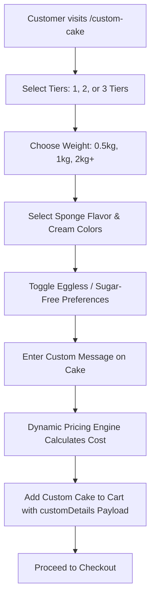
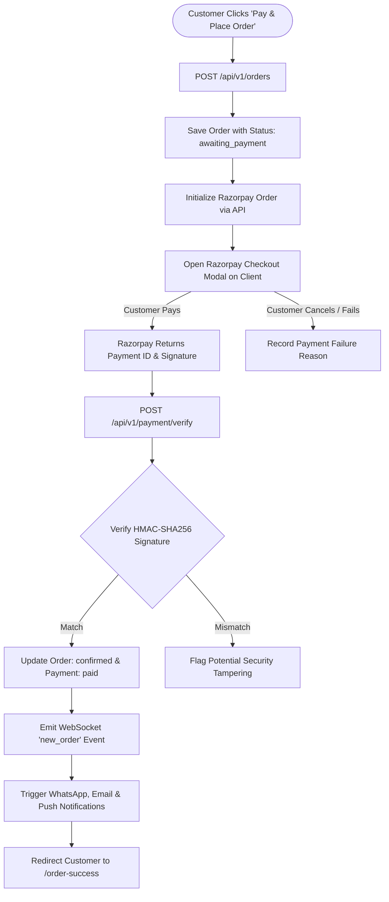
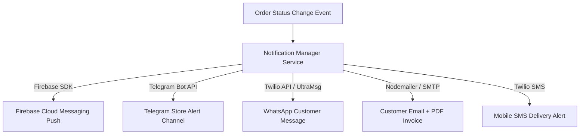

# Document 8: Business Logic & Workflows

This document specifies the operational business logic, state machine lifecycles, checkout workflows, payment verification algorithms, and multi-channel notification dispatch rules implemented in **The Chocolate Mine**.

---

## 1. Core E-Commerce Workflows

### 1.1 Custom 3D Cake Design & Customization Workflow

- **Trigger:** Customer clicks "Custom Cake Studio" in top navigation bar.
- **Preconditions:** WebGL support on customer device (fallback to 2D image preview).
- **Processing Steps:**
  1. Client renders 3D Canvas with base tier geometry.
  2. User selections update active 3D materials (color, texture, scale).
  3. Price calculator computes: $\text{Total} = \text{Base Tier Price} + (\text{Weight Multiplier}) + \text{Flavor Add-on Cost}$.
  4. Add to Cart serializes `customDetails` (tiers, weight, sponge, creamColor, messageOnCake, eggless).
- **Database Changes:** Persisted in Cart subdocument or Order `items.customDetails`.
- **Success Outcome:** Customized cake item attached to user cart with visual preview thumbnail.

---

### 1.2 Checkout & Razorpay Payment Verification Workflow

- **Trigger:** Customer submits checkout form on `/checkout`.
- **Preconditions:** Valid delivery address, future delivery date, cart total > 0.
- **HMAC Signature Verification Formula:**
  $$\text{Generated Signature} = \text{HMAC-SHA256}(\text{razorpay\_order\_id} + "|" + \text{razorpay\_payment\_id}, \text{RAZORPAY\_KEY\_SECRET})$$
- **Success Outcome:** Order status updated to `confirmed`, stock reserved, real-time alert dispatched to store staff.

---

## 2. Order Lifecycle State Machine

An order moves through distinct status stages managed by automated payment hooks and staff dashboard actions:

| Order Status | Trigger Event | Database Updates | Allowed Next Transitions |
| :--- | :--- | :--- | :--- |
| `awaiting_payment` | Order document generated; Razorpay order initialized. | `paymentStatus: 'pending'` | `confirmed`, `cancelled` |
| `confirmed` | Razorpay payment signature verified OR staff confirms cash order. | `paymentStatus: 'paid'`, `orderStatus: 'confirmed'` | `out_for_delivery`, `cancelled` |
| `out_for_delivery` | Staff marks order as dispatched and assigns delivery driver. | `orderStatus: 'out_for_delivery'` | `delivered` |
| `delivered` | Driver confirms delivery or delivery OTP verified. | `orderStatus: 'delivered'`, `deliveryOtpVerified: true` | Final State |
| `cancelled` | Payment failure, customer cancellation, or admin rejection. | `orderStatus: 'cancelled'`, `paymentStatus: 'failed'/'refunded'` | Final State |

---

## 3. Multi-Channel Notification Dispatch Matrix

When an order transitions state, the backend `notificationManager.js` service evaluates user preferences and dispatches notifications across 5 channels:

| Event Trigger | Target Recipient | Notification Channel | Payload / Content |
| :--- | :--- | :--- | :--- |
| **New Order Placed** | Store Administrator & Staff | Telegram & FCM Push | Instant audio chime + Order summary with items and delivery address. |
| **Payment Confirmed** | Customer | Email & WhatsApp | Payment receipt, estimated delivery slot, order tracking link. |
| **Out for Delivery** | Customer | WhatsApp & SMS | Delivery driver contact details + 4-digit Delivery OTP code. |
| **Order Delivered** | Customer | Email & Push Notification | Delivery confirmation receipt + link to rate and review products. |

---

## 4. Coupon Validation Logic

1. **Trigger:** Customer inputs coupon code (e.g. `CELEBRATE15`) during checkout.
2. **Validation Checks (`couponRoutes.js` / `Product.js`):**
   - Check if coupon code exists and is active.
   - Verify current date is between `startDate` and `endDate`.
   - Verify total usage count has not exceeded `usageLimit`.
   - Check minimum subtotal threshold requirement.
3. **Discount Computation:**
   - **Percentage Discount:** $\text{Discount} = \text{Subtotal} \times \left(\frac{\text{Percent}}{100}\right)$
   - **Flat Discount:** $\text{Discount} = \text{Flat Amount}$
4. **Outcome:** Subtracts calculated discount from Grand Total before submitting payment request.
